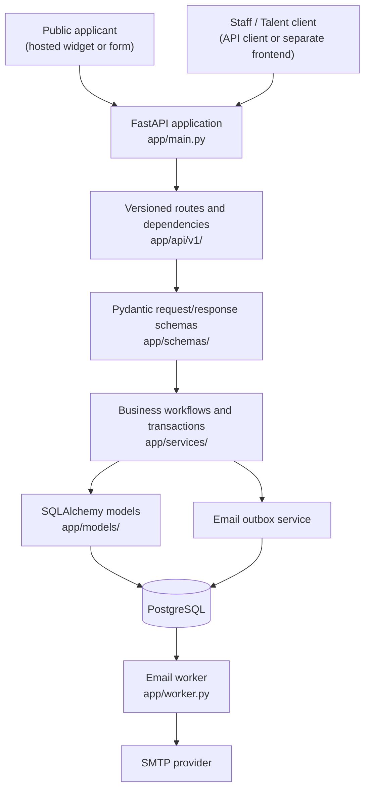

# CTMS High-Level Architecture

CTMS is a backend-first cohort and talent management system. It provides a versioned HTTP API, a public application form that can be embedded on an external site, PostgreSQL persistence, and a separate background worker for email delivery. There is no built-in staff administration web interface; staff use API clients such as the interactive FastAPI documentation or a separately built frontend.

For the entity relationships and database-level model, see [ERD.md](ERD.md). This document describes the system's components, boundaries, and user workflows.

## System overview

The API and worker are separate processes in one Python application package. They share configuration, service code, database models, and PostgreSQL, but email delivery runs outside the request/response path.

## Application structure

| Location | Responsibility |
| --- | --- |
| `app/main.py` | Creates the FastAPI application, configures CORS and validation handling, and mounts the versioned API. |
| `app/api/v1/endpoints/` | Defines HTTP routes and connects request data and dependencies to services. |
| `app/api/deps.py` | Opens database sessions, validates bearer access tokens, loads the active profile, and provides role checks. |
| `app/schemas/` | Validates request bodies and defines API response shapes. |
| `app/services/` | Implements workflows, access rules, and transaction boundaries. |
| `app/models/` | Maps application entities and relationships to PostgreSQL through SQLAlchemy. |
| `app/core/` | Holds shared configuration, database setup, and security helpers. |
| `app/cli.py` | Provides one-time Super Admin bootstrap and local demo-data commands. |
| `app/worker.py` | Processes due email-outbox records and retries delivery independently. |
| `alembic/` | Contains database schema migrations. |
| `widget/` | Contains the public application form and embeddable widget assets. |

The API layer stays focused on HTTP concerns. Services implement the application workflow and database operations; schemas handle input and output validation; models represent persisted data. PostgreSQL constraints complement service checks for durable invariants.

## Main user workflows

### Staff setup and administration

1. An operator creates the first Super Admin using `uv run python -m app.cli bootstrap-super-admin`. This is a CLI operation, not a public API route, and it refuses to create another Super Admin if one already exists.
2. Admins and Super Admins authenticate through `POST /api/v1/auth/login`. The returned bearer token is used for protected API calls.
3. Staff use the API to create cohorts and tracks, review applications, and manage profiles. Cohort creation also creates its general conversation and a conversation for each track.
4. Admins can create Mentors; only Super Admins can create Admins. Newly created Staff accounts remain inactive until they complete one-time password setup.

Staff and Mentors can access conversations across cohorts and tracks. Admin-only operations are restricted by role checks in the API dependencies and workflow handlers.

### Talent application and onboarding

1. Staff create a cohort with tracks. The system generates a public embed token for application intake.
2. A prospective Talent uses the hosted or embedded public form. The widget requests cohort and track options and submits the application using the cohort's embed token. Applying does not require an account or an access token.
3. The API checks that the cohort accepts applications, verifies the selected track belongs to it, and prevents duplicate applications for the same normalized email in that cohort.
4. An Admin or Super Admin reviews the application through the protected API. Approval creates an inactive Talent profile, marks the application approved, and records a password-setup email event in the outbox as one database transaction. Rejection does not create a profile.
5. The email worker claims the outbox event and sends the setup link through the configured SMTP provider. Delivery retries are handled by the worker; email sending does not happen inside the approval request.
6. The Talent redeems the single-use setup token to set a password and activate the account, then logs in to obtain an access token.
7. The active Talent can list and use only their cohort's general conversation and assigned track conversation. Suspended Talents are denied access.

### Messaging

An authenticated client calls `GET /api/v1/conversations` to discover conversation IDs available to that user. It then uses a conversation ID to retrieve message history or post a message under `/api/v1/conversations/{conversationId}/messages`.

The API derives the sender from the authenticated profile, not the message body. It checks access to the requested conversation on each history read and message creation. Staff can access all conversations; Talents are limited to their own cohort's general conversation and assigned track conversation.

## Request, security, and persistence flow

For a protected request, FastAPI resolves a database session and validates the bearer access token. The dependency loads the corresponding active profile; role-specific dependencies and service-level resource checks then enforce the applicable permissions. The endpoint validates and serializes data using Pydantic schemas and delegates workflow behavior to a service.

Services use SQLAlchemy to read and write PostgreSQL. Related state changes that must succeed together—such as cohort, tracks, and their conversations, or application approval, Talent profile, and outbox event—are committed transactionally. Alembic manages schema evolution.

Public application intake is intentionally separate from authenticated staff and Talent operations. Its embed token identifies the cohort's public intake configuration; it is not an authorization credential for protected API operations.

## Runtime and configuration

- FastAPI serves the API under `/api/v1`; its interactive documentation is available in development.
- PostgreSQL stores application data and the durable email outbox.
- Docker Compose provisions PostgreSQL and the separate `email-worker` process. The API can be run locally with Uvicorn.
- `app/core/config.py` loads application settings from `.env` and environment variables through Pydantic Settings.
- CORS is configured with explicit widget origins. The public widget does not use credentialed cross-origin requests.
- Alembic migrations establish and update the PostgreSQL schema.

For setup commands and local operation, see the [README](../README.md). For endpoint contracts, roles, and request/response details, see the [API specification](api-spec.md).
