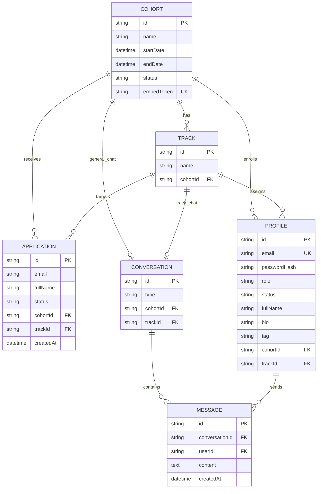

# CTMS Architecture and ERD

## Current intended architecture

The service is a Python 3.12+ FastAPI application backed by PostgreSQL and SQLAlchemy. Its intended structure separates HTTP routing, request dependencies, schemas, persistence models, business services, and infrastructure:

```text
HTTP client / public widget
          |
          v
FastAPI app (app/main.py)
          |
          v
Versioned API routers (app/api/v1/)
          |
          +---- dependencies: database session, authenticated Profile
          |
          v
Services (business rules, authorization, transactions)
          |
          v
SQLAlchemy models and PostgreSQL

Pydantic schemas validate inbound requests and shape API responses.
Alembic is the intended database migration tool.
```

The source tree contains modules corresponding to this design (`app/api`, `app/core`, `app/models`, `app/schemas`, and `app/services`). The current implementation is still a scaffold; the progress tracker records what is actually wired and implemented.

## Modular monolith boundaries

CTMS remains one application codebase and one PostgreSQL database, with modules owning clear responsibilities. API endpoint modules bind HTTP requests and responses; shared dependencies validate JWTs and load the active Profile; services enforce onboarding and authentication rules; models persist Profiles, setup-token hashes, and email-outbox events. The email worker is a separate process running the same application package. It claims durable outbox rows, sends mail through the SMTP adapter, and schedules retries without putting email delivery in the request path. Modules communicate through service functions and shared SQLAlchemy models rather than introducing network calls between internal components.

## ERD



## Entity and integrity rules

| Entity | Intended invariants |
| --- | --- |
| Cohort | Unique embed token. `startDate` and `endDate` are UTC instants. Intake closes when `now >= startDate`; a background status update is not required for enforcement. |
| Track | Belongs to exactly one Cohort. |
| Application | Email is trimmed and compared case-insensitively; unique by normalized email plus cohort. Its Track must belong to its Cohort. Status is `PENDING`, `APPROVED`, or `REJECTED`. |
| Profile | Email is globally unique. Role is `SUPER_ADMIN`, `ADMIN`, `MENTOR`, or `TALENT`; status is `ACTIVE`, `INACTIVE`, or `SUSPENDED`. A Talent requires cohort and track assignment; Staff assignments are optional. Active users have a password hash. |
| Conversation | Type is `GENERAL` or `TRACK`. A general conversation belongs to one Cohort; a track conversation belongs to one Track. There is at most one of each required conversation per Cohort/Track. |
| Message | Belongs to one Conversation and has one Profile sender. Sender is determined from authentication, not client input. |

The ERD expresses the intended model. Add database constraints and tests for rules that can be enforced relationally; enforce cross-record business rules in transactional service logic when necessary. In particular, ensure referenced tracks and conversations cannot be attached to the wrong cohort.

## Runtime responsibilities

- **API layer:** HTTP status codes, routing, request/response schema binding, and dependency wiring.
- **Authentication/authorization:** Validate bearer access tokens, resolve the current Profile, reject inactive/suspended accounts as required, and apply role/resource policies on every protected request.
- **Services:** Implement lifecycle transitions, normalized-email rules, time-window checks, resource authorization, and transaction boundaries.
- **Models/database:** Persist relational state and enforce uniqueness/foreign-key constraints.
- **External email adapter (planned):** Send one-time setup links without making provider-specific behavior part of the application lifecycle logic.
- **Email outbox (planned):** Persist a delivery event in the same transaction as approval and Profile creation; retry delivery independently so a temporary provider failure does not undo approval.
- **Bootstrap command (planned):** Create the first Super Admin only when none exists, using a one-time CLI path rather than a public API endpoint.
- **Widget client (planned):** Submit only public application data and present validation, success, duplicate, closed-intake, and network-error states.

## Transaction and authorization boundaries

- Creating a Cohort and all its Tracks and Conversations is one transaction.
- Approving an Application, creating its inactive Talent Profile, and updating the Application state must prevent partial or duplicate approval. Email delivery needs an explicit failure/retry policy.
- The agreed email policy is a durable outbox: approval, inactive Profile creation, and an outbox event are committed atomically; delivery retries do not roll back approval. Do not place plaintext passwords or unprotected setup credentials in logs or durable queue payloads.
- Public intake must rely on both service checks and database uniqueness to handle concurrent duplicate submissions.
- Every conversation listing, history read, and message write must authorize the authenticated user against the actual target resource.
- Keep secrets and password material out of logs and API responses. Store password hashes, never plaintext passwords.
- Talent Profiles have one cohort and track assignment at a time. A second approval for an email already associated with a Profile conflicts; multi-cohort enrollment is outside the MVP.
- Password setup tokens are single-use and expire after 24 hours. Access JWTs expire after 15 minutes; the MVP has no refresh-token flow.
- The first Super Admin is created by a one-time CLI command that refuses to run if one already exists. Newly onboarded Staff accounts remain inactive until they use the same one-time password setup flow as Talents.

## Source of truth and unresolved decisions

The ERD in `docs/ERD.md` and the endpoint contract in `docs/api-spec.md` define the intended product behavior, supplemented by the decisions above. Production sender domain, widget hosting/CORS/origin policy, and deployment remain open.
